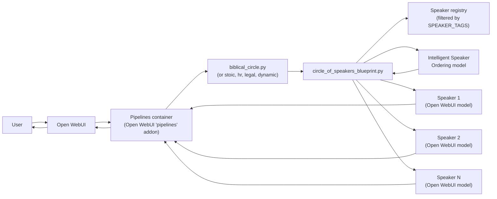

# Circle of Speakers — Multi-Persona Open WebUI Pipeline

[](https://chat.crossandfaith.com)
[](LICENSE)
[](https://openwebui.com)

A streaming Open WebUI **pipeline** that turns any tagged set of Open WebUI models into a **multi-speaker conversation** — one prompt, multiple distinct voices answering in turn, with intelligent ordering, dynamic introductions, and user-profile-aware response prefixes.

> 🚀 **Live in production:** [chat.crossandfaith.com](https://chat.crossandfaith.com) — sign in with Google, pick the `Biblical Circle` model, ask a question and watch the chosen biblical figures answer one after another in their own KJV-grounded voices.
>
> Background and architecture writeup: [damore.ai/blog/dynamic-circle-of-speakers-v2](https://www.damore.ai/blog/dynamic-circle-of-speakers-v2)

---

## What you get

- **One pipeline file per circle** — `biblical_circle.py`, `dynamic_circle.py`, `stoic_circle.py`, `hr_circle.py`, `legal_circle.py`. Each is a tiny ~100-line shim that sets `SPEAKER_TAGS` and inherits from the shared blueprint.
- **The shared `circle_of_speakers_blueprint.py`** (~1100 lines) does the heavy lifting:
  - Discovers Open WebUI models tagged for the circle
  - Sends the tag-filtered cast, recent conversation and the user's message to an **"Intelligent Speaker Ordering"** model and runs the speakers it names, in that order
  - Streams each chosen speaker's response in turn through Open WebUI
  - Injects a one-time introduction the first time each speaker appears
  - Personalizes responses by extracting profile info from the user's system prompt
- **38 ready-to-use biblical speaker prompts** (21 Old Testament + 2 NT non-apostles + 15 apostles) — drop-in system prompts for Open WebUI models, see [`prompts/biblical/`](prompts/biblical/).
- **Production-tested** — running 24/7 at [chat.crossandfaith.com](https://chat.crossandfaith.com) for weeks of real user traffic.

---

## How it works



Each "speaker" is just an Open WebUI model — could be a base model with a system prompt, a fine-tuned LoRA, or any other registered model. The blueprint filters which ones participate in a given circle by tag (`biblical`, `stoic`, etc.) and lets the **Intelligent Speaker Ordering** model decide who responds next based on the conversation so far.

### Speaker ordering contract

The selection rules live in Open WebUI, not in Python. The pipeline only sends data and validates the answer:

- The ordering model's **Open WebUI system prompt** owns every selection rule (how many speakers, mandatory mentions, ordering). Edit it in the Open WebUI model editor; there is no prompt text to change in the pipeline.
- The pipeline sends one user message containing `AVAILABLE CAST` (name, description and tags of every model that matches `SPEAKER_TAGS`), `RECENT CONVERSATION` (the last `DECISION_CONTEXT_DEPTH` rounds, plus memory context when present) and `USER'S MESSAGE`.
- Reasoning / thinking / usage marker chunks from the ordering model are ignored, so a reasoning model works as the orderer.
- Only **exact** names from the filtered cast are accepted. Invented or partial names are logged and dropped; if nothing valid remains the pipeline raises an orchestration error instead of guessing.

The cleanup that produced this contract is documented in [`docs/orchestration-cleanup-handoff.md`](docs/orchestration-cleanup-handoff.md).

### Speaker thumbnails

Each speaker's turn starts with a markdown image followed by the bold speaker name. Open WebUI renders images inside message content at their **native pixel size** (there is no size syntax, and raw `` tags are shown as text in chat), so the image has to arrive already small. `PROFILE_THUMBNAIL_ROOT` is a URL template with two placeholders, `{model_id}` (URL-encoded) and `{size}`:

```text
 **{name}**:
```

The default asks Open WebUI itself for the speaker model's avatar. The `width` parameter is a proposed Open WebUI feature ([discussion #32756](https://github.com/open-webui/open-webui/discussions/32756), branch [`feature/model-profile-image-width`](https://github.com/beaudamore/open-webui/tree/feature/model-profile-image-width)); stock Open WebUI ignores it and serves the stored 250 px avatar. Users need read access to the speaker models, otherwise Open WebUI returns its default logo.

A root without placeholders is treated as a prefix, `{root}{model_id}?width={size}`, which is the form an external resizer such as [`image_resizer`](https://github.com/beaudamore/image_resizer) expects. Leave `PROFILE_THUMBNAIL_ROOT` empty to print names only. The small round avatar Open WebUI shows next to the message belongs to the circle pipeline model itself; it is scaled by CSS and cannot be changed per speaker.

---

## Quick start

### Prerequisites

- A running [Open WebUI](https://openwebui.com) instance with the **Pipelines** addon enabled.
- One or more registered Open WebUI models tagged for your circle (e.g., tag = `biblical`).
- An "Intelligent Speaker Ordering" model registered in Open WebUI — any chat model with the system prompt from [`prompts/base/intelligent_speaker_ordering.md`](prompts/base/intelligent_speaker_ordering.md) (or [`intelligent_speaker_ordering_v2.md`](prompts/base/intelligent_speaker_ordering_v2.md), which adds an explicit "only use names from the list" rule). The pipeline validates names exactly, so the prompt must tell the model to copy them verbatim.
- The circle model's own system prompt (set in Open WebUI on the `Biblical Circle` model) is the per-speaker template from [`prompts/base/pipeline_prompt.md`](prompts/base/pipeline_prompt.md); the pipeline reads it from the request and fills in `{speaker_name}`, `{user_message}` and the other placeholders.

### Install a circle

1. Drop the desired circle file into your Pipelines container's `pipelines/` directory:

   ```sh
   cp pipelines/biblical_circle.py /path/to/openwebui/pipelines/
   ```

2. Drop the shared blueprint into the path the circle imports from. The default is `/app/blueprints` inside the Pipelines container — mount or copy:

   ```sh
   cp pipelines/blueprints/*.py /path/to/openwebui/blueprints/
   ```

3. Open WebUI auto-reloads pipelines on file change. The new `Biblical Circle` (or whichever) will appear as a model in the model picker.

4. Open the model's valves in the Open WebUI admin UI:
   - `OPENWEBUI_ENDPOINT` → your Open WebUI URL (default `http://host.docker.internal:3000`)
   - `OPENWEBUI_API_KEY` → a JWT token from an Open WebUI admin user
   - `SPEAKER_TAGS` → the tag(s) you assigned to circle-eligible models (default for `biblical_circle.py` is `biblical`)

That's it. Send a message and the circle responds.

### Add a new persona to an existing circle

1. Register a new Open WebUI model (any base + system prompt, or fine-tuned LoRA).
2. Tag it with the circle's tag (`biblical`, `stoic`, etc.).
3. Open WebUI tells the pipeline about it on the next request — no code change.

This is the architectural decoupling that makes the pipeline persona-agnostic. Change the tag set, get a different circle.

---

## Available circles

| Pipeline | `SPEAKER_TAGS` | Use case |
| --- | --- | --- |
| `biblical_circle.py` | `biblical` | Biblical figures only — what powers chat.crossandfaith.com |
| `stoic_circle.py` | `stoic` | Stoic philosophers (Marcus Aurelius, Seneca, Epictetus, …) |
| `hr_circle.py` | `hr` | Workplace / HR personas |
| `legal_circle.py` | `legal` | Legal advisor personas |
| `dynamic_circle.py` | (configurable) | The base, no fixed tag — set tags in valves |

All five are 100-line subclasses of [`pipelines/blueprints/circle_of_speakers_blueprint.py`](pipelines/blueprints/circle_of_speakers_blueprint.py). Adding a new circle is three lines: subclass, set `SPEAKER_TAGS`, save.

---

## The 38 biblical speakers

See [`prompts/biblical/README.md`](prompts/biblical/README.md) for the full roster.

```text
prompts/biblical/
├── old-testament/          21 figures (Amos, Daniel, David, ... Zephaniah)
└── new-testament/
    ├── james-the-brother-of-jesus.md
    ├── jude-contender-for-the-faith.md
    └── apostles/           15 figures (the 12 + Paul + Barnabas + Matthias)
```

**26 of these are also fine-tuned LoRA voices** trained on KJV per-persona corpora; the model layer (separate work) lives at [`github.com/beaudamore/biblical`](https://github.com/beaudamore/biblical). The remaining 12 apostle prompts run as system-prompt-driven personas on the base model and are slated for future fine-tuning.

---

## Configuration cheat sheet

The full set of valves is documented inline in [`pipelines/blueprints/circle_of_speakers_blueprint.py`](pipelines/blueprints/circle_of_speakers_blueprint.py). The most-touched ones:

| Valve | Default | What it does |
| --- | --- | --- |
| `OPENWEBUI_ENDPOINT` | `http://host.docker.internal:3000` | Open WebUI URL as seen from the Pipelines container. |
| `OPENWEBUI_API_KEY` | (empty, required) | Admin JWT used to list models and call speakers. |
| `SPEAKER_TAGS` | `""` (set per circle) | Comma = OR, plus = AND. Filters the model registry. |
| `ORCHESTRATION_MODEL_NAME` | `Intelligent Speaker Ordering` | The Open WebUI model that decides turn order. Its Open WebUI system prompt holds the rules. |
| `DECISION_CONTEXT_DEPTH` | `4` | How many recent rounds the orderer sees. |
| `HISTORY_MAX_ROUNDS` | `0` | Rounds of prior history kept when building context (`0` = all). |
| `ENABLE_DYNAMIC_INTRODUCTIONS` | `true` | One-time intro the first time each speaker appears in a conversation. |
| `ENABLE_USER_PROFILE_INTEGRATION` | `true` | Extracts personal info from the user's system prompt and weaves it into responses. |
| `PROFILE_THUMBNAIL_ROOT` | `/api/v1/models/model/profile/image?id={model_id}&width={size}` | Avatar URL template. No placeholders = prefix form for external resizers. Empty = names only. |
| `PROFILE_IMAGE_SIZE` | `60` | Pixel width filled into `{size}`. |
| `FIRST_SPEAKER_PROMPT_PREFIX` / `INTRODUCTION_PROMPT_PREFIX` | (text) | Prefixes added to the speaker template for the opening speaker and for first appearances. |
| `enable_full_debug` / `enable_step_debug` | `false` | Verbose logging while you're tuning. |

---

## Project structure

```text
.
├── README.md
├── LICENSE
├── docs/
│   └── orchestration-cleanup-handoff.md       Why ordering rules live in Open WebUI
├── pipelines/
│   ├── blueprints/
│   │   ├── circle_of_speakers_blueprint.py    The reusable base
│   │   └── openwebui_streaming_blueprint.py   Lower-level streaming utilities
│   ├── biblical_circle.py
│   ├── dynamic_circle.py
│   ├── hr_circle.py
│   ├── legal_circle.py
│   └── stoic_circle.py
└── prompts/
    ├── base/                                  Speaker-ordering + pipeline prompts
    ├── biblical/                              38 biblical figures
    └── shakespeare/
```

---

## Production context

The pipeline is one piece of a larger production stack at [chat.crossandfaith.com](https://chat.crossandfaith.com): it sits between Open WebUI and a vLLM server hosting **Qwen3-14B** with hot-swapped LoRA adapters (biblical / augustine / liguori). The runtime fronts a 17-container deployment with Postgres, encrypted-at-rest storage, Cloudflare TLS, Trivy vulnerability scanning, and SOC 2 Type II policy coverage.

Detailed writeup: [damore.ai/blog/dynamic-circle-of-speakers-v2](https://www.damore.ai/blog/dynamic-circle-of-speakers-v2)

---

## Related projects

- **Model layer (LoRA adapters):** [github.com/beaudamore/biblical](https://github.com/beaudamore/biblical) — the fine-tuning pipeline that produces the 26 biblical voices.
- **Live deployment:** [chat.crossandfaith.com](https://chat.crossandfaith.com)
- **Project blog:** [damore.ai/blog](https://www.damore.ai/blog)
- **Open WebUI:** [openwebui.com](https://openwebui.com)

---

## Author

Built by [Beau D'Amore](https://damore.ai) — AI Solutions Architect specializing in OpenWebUI, vLLM, LLM fine-tuning, and private AI infrastructure.

- 🌐 [damore.ai](https://www.damore.ai)
- 💬 [chat.crossandfaith.com](https://chat.crossandfaith.com) (live demo)
- 🐙 [github.com/beaudamore](https://github.com/beaudamore)
- 💼 [linkedin.com/in/beaudamore](https://linkedin.com/in/beaudamore)
